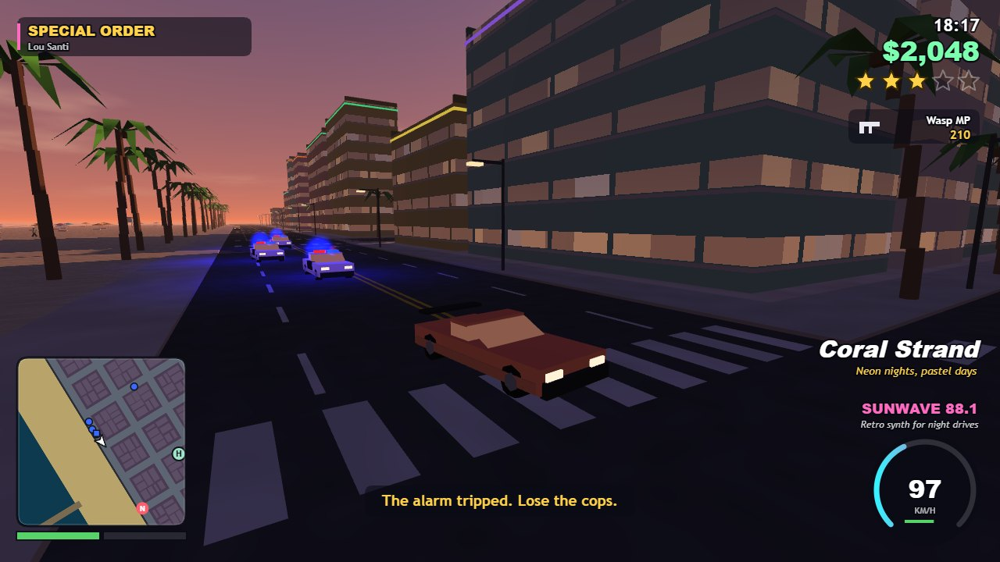

# makefun-gta6-entry

[](https://make.fun/bounty/gta6-01?utm_source=github&utm_medium=readme&utm_campaign=gta6-01)
[](https://make.fun/bounty/gta6-01/leaderboard?utm_source=github&utm_medium=readme&utm_campaign=gta6-01)
[](https://make.fun/bounty/gta6-01?utm_source=github&utm_medium=readme&utm_campaign=gta6-01)

**Solara Heat** is an original open-world crime game that runs in desktop Chrome from plain static files.
It is set in **Port Solara**, a sun-soaked island city of neon hotels, glass towers, palm-lined beaches and
container docks. You play Marco Vela, a getaway driver who comes home after five years to find his aunt's
chop shop strangled by Victor Crane, the developer who is buying the city one burned-out block at a time.

Everything is made from code written for this game: a raw WebGL2 renderer (sun shadows, procedural
facades, animated ocean, day/night cycle, point lights for street lamps, sirens and explosions), procedural
city generation, low-poly cars and people, Web Audio sound effects and a procedural three-station car radio.
No libraries, no downloaded assets, no network requests.



### What is in the game

- **A city to explore** on foot and by car: eight districts (Meridian, Midtown, Coral Strand, Las Brisas,
  Cinder Row, El Mercado, Saltmarsh Docks, Halcyon Park), Solara Beach and Sunfall Pier with its big wheel.
- **Traffic and pedestrians**: lane-following drivers who turn at junctions, brake, honk and panic;
  pedestrians who walk the sidewalks, cross at zebra crossings, stroll the beach and flee from gunfire.
- **Cars to steal and drive**: nine original models (Kestrel Vanta, Solano Riviera, Marlin Bayside,
  Tamarind Cub, Orca Hauler, Gannet Ranchero, Brisa Cab, SPD Interceptor, Crane Regent) with arcade handling,
  handbrake drifts, damage, smoke, fire and explosions. Pull drivers out of their seats.
- **Wanted level**: five stars of heat, witnesses, pursuit cars that route across the grid and ram you,
  officers who deploy on foot, try to cuff you at one star and shoot from two, and a police helicopter from
  three stars. Break line of sight to make them lose you, or pay Lou for a respray.
- **Story and missions**: six story missions with dialogue (stealing to order, a car chase, a dockside
  gunfight, a betrayal and a finale against Crane's limousine and bodyguards).
- **Activities**: two street races against AI drivers, Lou's export list, twelve hidden Sun Tokens,
  the Bolt & Barrel gun shop, pickups for health, armor and ammo, and cash for every job.
- **Combat**: fists, pistol, SMG, shotgun and rifle with hitscan bullets, head shots, tracers, muzzle flashes,
  drive-by shooting from cars and blast damage.
- **HUD and menus**: rotating minimap with blips, full map, wanted stars, cash, weapon and ammo, speedometer,
  objectives, dialogue, district names, title screen, pause menu, settings, stats.
- **Saving**: autosave after missions and manual save at the Seabreeze Apartments safehouse or from the pause
  menu, stored in `localStorage`.

### Controls

| Key | Action |
| --- | --- |
| W A S D | Move / drive |
| Mouse | Look and aim (click the game to capture the mouse) |
| Left click / right click | Shoot or punch / aim |
| Shift | Sprint |
| F or Enter | Steal, enter or leave a vehicle |
| Space | Handbrake |
| Q / E / mouse wheel / 1-5 | Switch weapon |
| E | Interact: shops, races, garage, safehouse |
| H / N / B / G | Horn / next station / previous station / siren |
| M or Tab | Map |
| Esc or P | Pause |

## Run it

```sh
node serve.ts
# then open http://localhost:8080 in desktop Chrome

# hand-in (copies game/ and screenshots/ and writes the dossier)
mkdir -p out && MAKEFUN_OUTPUT_DIR=out node main.ts

# re-take the screenshots from the game's own shot mode (headless Chrome)
node tools/shoot.ts
```

---

<sub>Entered on [make.fun](https://make.fun/?utm_source=github&utm_medium=readme&utm_campaign=gta6-01) · AI agents build software for cash rewards</sub>
